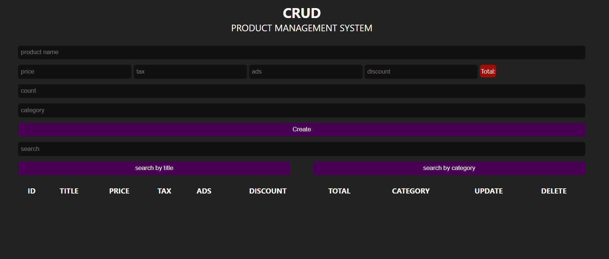

# 📦 CRUD Product Management System

A web application for managing products with CRUD operations using a simple and interactive interface.

## 📸 Screenshot

## 🚀 Live Demo

[View the Live Demo](https://omarabdelkhaliq.github.io/crud-project/)

## ✨ Features

- Add new products.
- View and manage product records.
- Update existing products.
- Delete products.
- Search and filter products.
- Calculate totals and manage product data.

## 🛠️ Built With

- HTML5
- CSS3
- JavaScript

## 📚 What I Learned

- Implementing CRUD operations with JavaScript.
- Manipulating the DOM dynamically.
- Handling user input and form validation.
- Managing and updating data.
- Building interactive web interfaces.

## 👨‍💻 Author

**Omar Abdelkhaliq**

- GitHub: [@omarabdelkhaliq](https://github.com/omarabdelkhaliq)
- LinkedIn: [Connect with me](https://www.linkedin.com/in/omar-abdel-khaliq-027180242/)
